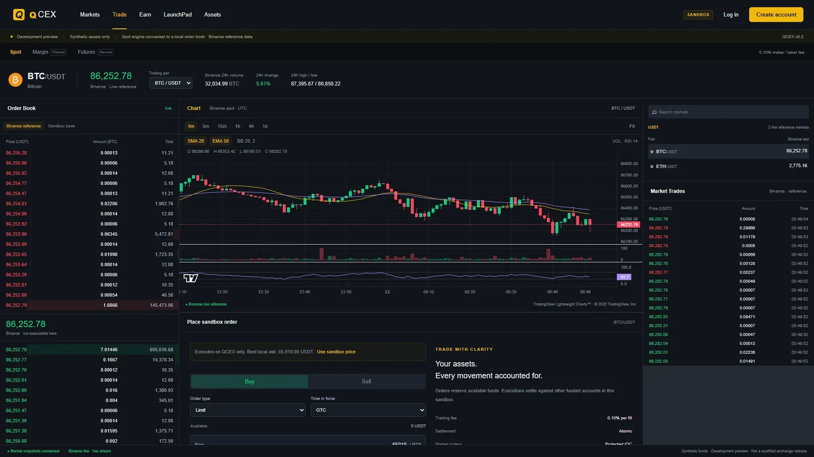
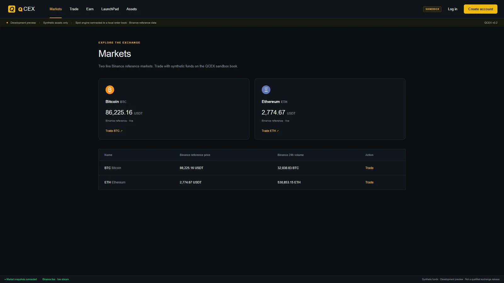
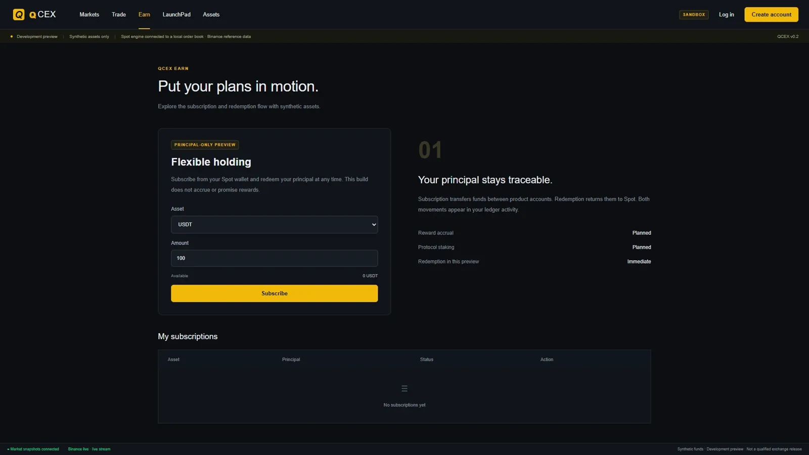
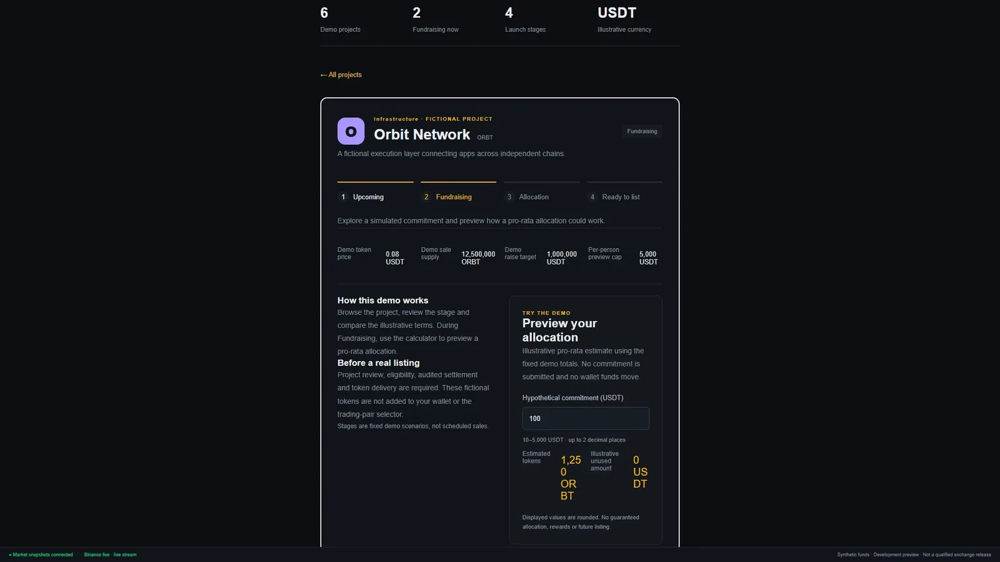

# QCEX — spot exchange & ledger sandbox (Next.js + Spring Boot + MySQL)
 

> **Need it installed, customised or supported?** Quantellics installs, customises and supports QCEX on your infrastructure, under your brand. → **[Book a call](https://quantellics.com)** · email: info@quantellics.com

<p align="center"></p>

## What it is (and isn't)
**Maturity: sandbox v0.2.**
- Spot/accounting sandbox: BTC/USDT and ETH/USDT with live Binance reference data and TradingView Lightweight Charts.
- Next.js client, Spring Boot exchange service, append-only MySQL ledger, LaunchPad and wallet *simulation*.
- Margin, derivatives, staking and production operation are **not** implemented.

- **Not investment advice.** Nothing here is financial, legal or tax advice.
- **No KYC, custody or licensing included.** You are responsible for KYC/AML, custody of user funds and any licence your activity requires.
- **Check your jurisdiction.** Operating trading, exchange or tokenisation services is regulated or prohibited in many jurisdictions.

> **Custody / KYC disclaimer:** QCEX holds no real assets. Wallets are simulated; there is no custody, KYC/AML, travel-rule, surveillance or licensing integration. Running an exchange with real user funds requires licensed custody, KYC and regulatory approval in your jurisdiction.

## 2-minute quickstart
```bash
git clone <repository-url> QCEX && cd QCEX
npm ci
npm run typecheck && npm run build    # web client
# full preview (needs Docker): docker compose --profile preview up -d --build --wait
```
Verify: `npm run test:e2e` (Playwright, needs the Docker preview running).

## Screenshots

<table><tr><td width="33%"><br /><sub>Markets list</sub></td><td width="33%"><br /><sub>Earn</sub></td><td width="33%"><br /><sub>LaunchPad demo</sub></td></tr></table>

## Customisation map
| What you want to change | Where it lives |
|---|---|
| Branding, UI | `apps/web/` |
| Markets, pairs, fees, amounts | `services/exchange/src/main/java/com/qcex/` (`trading/Trading.java`, `core/Amounts.java`) |
| Ledger schema | `services/exchange/src/main/resources/db/migration/` |
| Market data source | `services/market-data/` |
| Shared API contracts | `packages/contracts/` |
| Deployment | `compose.yaml`, `deploy/` |
| KYC provider | not included — integration point is a Launch/Dedicated engagement |

## Services: DIY vs Quantellics
| | Self-host (free) | **Install** | **Customise (Launch)** | **Dedicated support** |
|---|---|---|---|---|
| Source code (AGPL-3.0) | ✓ | ✓ | ✓ | ✓ |
| Installed on your infra / domain | you | ✓ | ✓ | ✓ |
| Branding, features, markets | you | – | ✓ | ✓ |
| Security review, KYC/payments integration | – | – | ✓ | ✓ |
| SLA, on-call, upgrades | – | – | – | ✓ |
| Commercial licence (no AGPL obligations) | – | available | available | included |
| Price | free | Contact us for pricing — info@quantellics.com | Contact us for pricing — info@quantellics.com | Contact us for pricing — info@quantellics.com |

See [SUPPORT.md](SUPPORT.md) or [open an enquiry](../../issues/new?template=enquiry.yml).

## Licence
**AGPL-3.0** ([LICENSE](LICENSE)). If you run a modified version as a network service, you must publish your changes under AGPL-3.0.
Need proprietary/closed-source use? A **commercial licence** is available — see [COMMERCIAL-LICENSE.md](COMMERCIAL-LICENSE.md).
"Quantellics" and product names are trademarks and are not licensed under AGPL.

> **Need it installed, customised or supported?** Quantellics installs, customises and supports QCEX on your infrastructure, under your brand. → **[Book a call](https://quantellics.com)** · email: info@quantellics.com

---

## Technical reference (previous README)

# QCEX

This repository contains a **spot/accounting sandbox preview** with live Binance reference data for **BTC/USDT and ETH/USDT**, TradingView Lightweight Charts, a Next.js client, Spring Boot service and MySQL ledger. The full 71-node exchange graph remains in progress; margin, derivatives, staking and production operation are not implemented.

## Run the development preview

With Docker Desktop running, from this directory in PowerShell:

```powershell
./scripts/bootstrap.ps1
docker compose --profile preview up -d --build --wait
```

Open **http://127.0.0.1:3100** and create a sandbox account. Accounts receive synthetic USDT, BTC, ETH and SOL. There are no real deposits, withdrawals or external signing capabilities. This preview does not satisfy the final N64 release gate.

```powershell
docker compose --profile preview ps
docker compose --profile preview logs --tail 100 api web market-data
docker compose --profile preview stop
docker compose --profile preview start
```

The named `qcex_mysql-data` volume retains state. Do not use volume-removal commands for ordinary shutdown. Database credentials are generated into ignored `.env`; the repository and images do not contain them. Services bind to loopback on ports 3100, 8088 and 3308. No public hosting is configured.

The fourth service, `market-data`, connects to Binance's public market-data-only REST/WebSocket hosts. It needs internet access but no API key, exchange account, DB credentials or published port. Feed outages are shown as stale; local account and order operations remain available. Only BTC/USDT and ETH/USDT accept new trades. Existing SOL balances/history remain available and old orders remain cancellable.

Charts show Binance candles with volume, SMA20, EMA50, Bollinger20/2 and RSI14. Intervals: 1m, 5m, 15m, 1h, 4h and 1d. The reference book and tape are external market data. **Orders execute only against the separately labeled QCEX sandbox book**, whose funded quotes are synthetic. There is no external order routing or fabricated local trading activity. See `THIRD_PARTY_NOTICES.md` for chart attribution.

Layouts adapt to desktop/laptop, tablet and mobile. The main navigation has direct tabs, keyboard controls, hash deep links and browser Back support. Data tables scroll horizontally on smaller screens.

## Verify

Node 24 and a Java 25+ JDK are required for host development. `bootstrap.ps1` downloads checksum-verified Maven 3.9.16 into `.tools`.

```powershell
npm ci
./scripts/test-backend.ps1
npm run typecheck
node --test services/market-data/core.test.mjs tests/indicators.test.ts
npm run build
npm run test:e2e
```


The backend test script creates a separate MySQL test database and runs the real-database oracle and rollback checks. The browser suite uses installed Chrome on Windows; CI must install Playwright's matching Chromium or select an available channel. Tests create synthetic users and exercise the running preview. Browser artifacts and summaries are saved under `artifacts`; traces may contain session credentials, so do not publish raw traces.

The fee suite checks one million seeded fee calculations. The matcher suite compares 1,000 generated commands with a separate integer/list oracle. Neither is a claim that the original million-ledger-operation or ten-million-engine-command gates are complete.

Journal and posting rows are append-only at the database layer. The isolated development MySQL server permits its migration account to create these triggers with binary logging enabled; production migration privileges are not configured by this preview.

## Edit locally

Start only the database with `docker compose up -d mysql`, then run `./scripts/start-api.ps1`, `node services/market-data/server.mjs` and `npm run dev` in separate terminals. Stop preview API/web containers first to free their local ports. Changes to contracts and financial code require affected tests and fresh build evidence.

## Backup and recovery rehearsal

```powershell
./scripts/backup.ps1 -OutputFile ./artifacts/backups/manual.sql
./scripts/restore-rehearsal.ps1 -BackupFile ./artifacts/backups/manual.sql
```

Restore rehearsal imports into a new isolated schema and checks journal/balance reconciliation; it does not overwrite the live database. Backups contain synthetic account/password/session data and must remain private. This is a same-host rehearsal, not an off-host disaster-recovery qualification. Upgrade by backing up, building the candidate, running affected tests and applying migrations through the new API image. Schema downgrades are not automatic; restore an approved snapshot to an isolated database and verify before switching.

## Source of truth

- `packages/contracts/README.md`: first-slice financial contract and architecture limits.

The UI labels unavailable products, external reference markets and actual local fill history separately. Principal-only Earn has no reward accrual. Publicly observed Binance workflows inform the plan; private-stack equivalence is unverified.

## Demo account

Run `node scripts/seed-demo.mjs` after starting Docker to provision the synthetic demo. Sign in as `qcex_demo`, password `QCEX_Demo_2026!`, demo verification code `123456`. The fixed code is a demonstration, not real MFA. The hosted sandbox uses the same shared public demo login. Change these credentials before exposing your own deployment. Includes spot orders/trades, transfers and principal-only Earn. Re-running resumes without resetting activity.

## Hosted sandbox

Live: https://qcex.quantellics.com. Hetzner deployment and dependency installation: [deploy/README.md](deploy/README.md). The hosted sandbox uses its own database and a shared public demo account (synthetic data, no real money, may be reset).

## LaunchPad and wallet demo

LaunchPad shows six fictional projects across four stages with allocation previews. Assets contains per-asset synthetic Deposit/Withdraw flows and movement history. The seeded demo starts at **$69,420** using fixed snapshot valuations; user activity changes its value. It does not receive or send real crypto. Login fields are prefilled; Development content is retained only in the engineering vault. The app reuses the Quantellics favicon.
